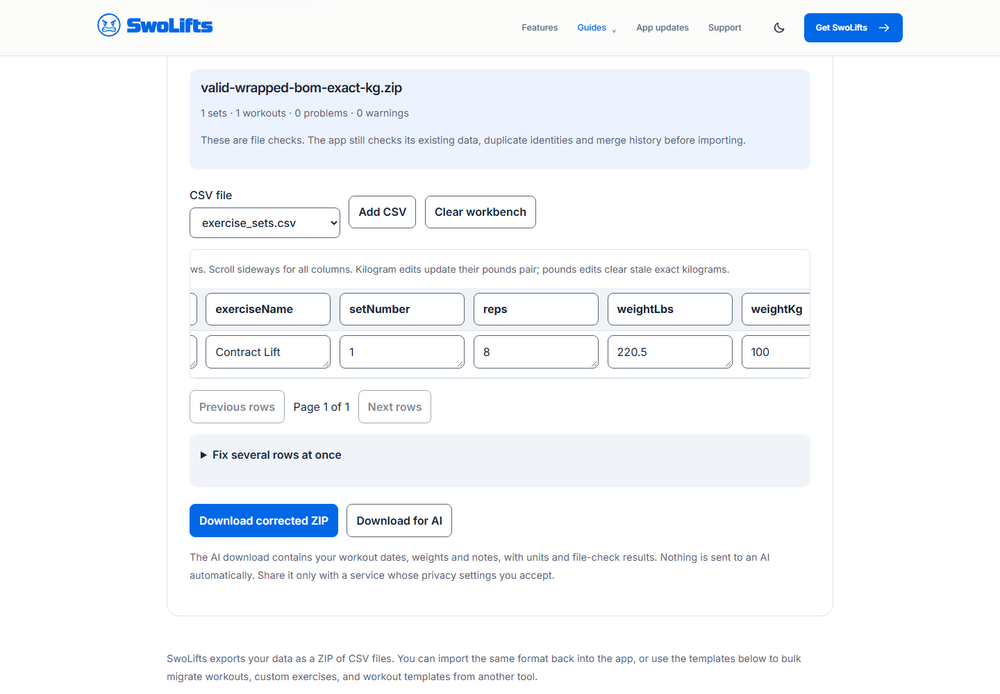
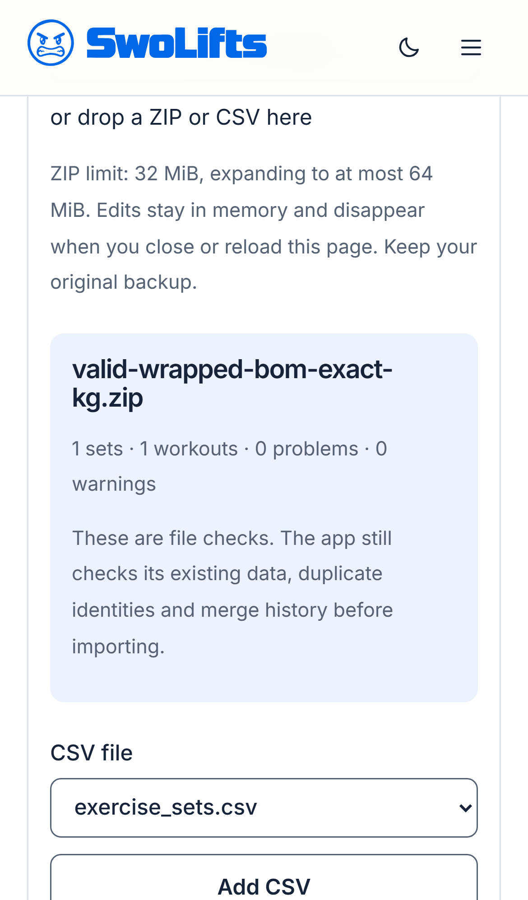
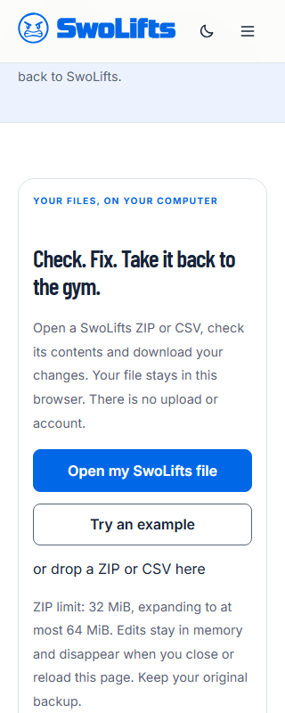
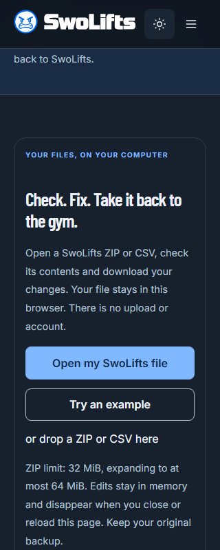

# WEB-WORKBENCH-01: offline file workbench

- Tracking: [website #54](https://github.com/maxilmarcus/maxil-website/issues/54).
- Release: [SwoLifts #497 / RELEASE-120-01](https://github.com/maxilmarcus/SwoLifts/issues/497).
- Android transfer: [#502 / TRANSFER-APP-01](https://github.com/maxilmarcus/SwoLifts/pull/502).
- Required review: Claude; Data, Security/Privacy, Product/UX and Accessibility.
- Status: Independent follow-up review accepted at `1831df3`; existing build, 26 unit tests and 54 browser tests passed. Integrated transfer source pin and branded 1.2.0 candidate screenshots are prepared; final website validation and Android release approval remain. Production deployment stays separately owner-gated after Android 1.2.0 is live.

Owner scope decision, 2026-10-25: present the workbench as a SwoLifts ZIP
backup checker and restore aid, with optional local analysis. Blank and example
CSVs remain format references. Do not advertise a guided historical import from
another workout app in the 1.2.0 release; no such conversion flow is provided.

Owner clarification, 2026-10-28: remove the duplicate Import & export link
from Guides; Workbench is the main navigation destination. Guides links directly
to Using SwoLifts while there is only one guide, without a dropdown. Website guidance,
FAQs and downloadable README files must describe restoring the original,
unchanged SwoLifts ZIP, not an edit-and-reimport workflow. Existing editing
controls produce a separate analysis copy; their downloads are labeled as
such. Making the website table read-only is an open owner choice, not yet
implemented. It would not disable Android backup export or restore.

## Contract and behavior

Android source is pinned to `c86db4c8f95ec7f7905763225df55b3392b8709e`:
[transfer contract](https://github.com/maxilmarcus/SwoLifts/blob/c86db4c8f95ec7f7905763225df55b3392b8709e/docs/engineering/OFFLINE_BACKUP_TRANSFER.md),
[importer](https://github.com/maxilmarcus/SwoLifts/blob/c86db4c8f95ec7f7905763225df55b3392b8709e/app/src/main/java/com/swolifts/app/data/export/DataExportImportManager.kt),
and [canonical fixtures](https://github.com/maxilmarcus/SwoLifts/tree/c86db4c8f95ec7f7905763225df55b3392b8709e/app/src/androidTest/assets/transfer-v1).
Local fixture hashes and the exercise reference source hash are recorded in
[`source.json`](../tests/fixtures/transfer-v1/source.json).

The catalog has a separate source pin at merged Android commit
`4033f56e6fd9acfb2b2cc45aca38256ea6ddfa28` (CATALOG-CURATION-01 / #505):
generation 2, 453 exercises. The transfer fixture pin above is unchanged.
Both templates retain the original 379 identities and add the 74 reviewed
exercises. They include the full canonical CSV and the matching ODbL notice;
the page also offers both files directly. Corrected ZIP downloads preserve
the notice and full catalog. Personal data is outside the catalog license.

| Limit | Value |
|---|---|
| Compressed input / expanded ZIP data | 32 MiB / 64 MiB |
| ZIP entries, including ignored entries | 128 |
| Data CSV rows / columns / total cells | 100,000 / 64 / 1,000,000 |
| Characters per cell | 65,536 |

The workbench checks required columns, scalar ranges, canonical UTC dates,
identity references available in the file, and known duplicate/deletion/merge
hazards. It does not have access to the receiving app's database. Missing
device-only exercises and existing-state effects are warnings; invalid values
are errors so a user does not unknowingly download values the app will discard.
The date checker requires the documented complete UTC form, even where the Java
date parser may tolerate trailing text or non-padded components. Date fixes only
normalize real ISO values with an explicit zone, or date-only values to midnight
UTC. Ambiguous locale dates are left for the user.

Editing kilograms updates the rounded pounds pair; editing pounds clears stale
exact kilograms. Unknown columns, multiline notes, IDs, tombstones and unrelated
ZIP entries survive export. Bulk trim changes known scalar fields, preserving
notes, descriptions, names, identity fields and unknown values. Column headers
are read-only. Bulk edits have one-step Undo; name mapping previews its affected
row count before confirmation. Mapping names also updates an existing
UUID column. Only a unique included reference/custom exercise can be selected.

The table displays 20 rows at a time. Validation is debounced by 200 ms; downloads
and name mapping remain disabled until the current edit is validated. Downloading creates a new file; the browser
never overwrites the original. Edits are in React memory only. Reload/close loses
them. Replacing/clearing a modified file requires confirmation. There is no
automatic AI call: the AI download is readable JSON with units, tables and file
warnings, plus an explicit user privacy note.

## Dependencies and transfer instructions

zip.js is pinned to 2.24.0 and its BSD license is shipped at
[`assets/licenses/zip-js.txt`](../assets/licenses/zip-js.txt).
[Official API](https://gildas-lormeau.github.io/zip.js/api/classes/ZipReader.html)
documents the reader; the native-stream module avoids worker/WASM network loads.
CRC checks and actual expanded-byte accounting are enabled before CSV parsing.
Path traversal and encrypted archives are rejected.

Quick Share instructions link to Google's
[Windows download](https://www.android.com/quick-share/with-windows-pc/) and
[transfer help](https://support.google.com/android/answer/13801258?hl=en).
The transfer pictures are synthetic emulator captures from the Android 1.2.0
preparation branch at `3a166fa921794f7e2f6fe4b7241cc015f6de4195` after #512 integration, using the disposable
`.debug` package and the tracked `valid-wrapped-bom-exact-kg.zip` fixture. No
owner data or phone capture is included. `send-to-computer.png` SHA-256 is
`386a461b6ccca6032f2fb041bd05365e589392994c5d4e3b0327352175cff949`;
`import-preview.png` SHA-256 is
`77234ad6f85419fef8597a3ebf56491e1d050061fe288f00c4cdc6afe4601e97`.
They show SwoLifts' Settings and pre-import confirmation; they are not proof of
Windows radio delivery. The owner-assisted phone/Windows Quick Share round trip with a
workbench-edited template passed in [Android #502's acceptance evidence](https://github.com/maxilmarcus/SwoLifts/pull/502#issuecomment-6357824699).
USB/file-picker instructions are retained.

## Validation

Node 24.22.0 / Chromium 156.0.8078.4, 2026-10-17:

- `npm run build`: passed; all eight routes prerendered.
- `npm test -- --output=.qa/workbench-final-results`: 22 unit and 46 browser tests
  passed, zero failures. Desktop and mobile cover the shared fixture flows.
- Primary buttons and error text meet 4.5:1 contrast in both themes; keyboard
  opening, post-load summary focus and row-error focus pass. Narrow pages fit
  320px; the editable table scrolls horizontally.
- Original network coverage began after navigation and missed the inherited
  Cloudflare beacon. Claude correctly caught this gap; that earlier result was
  insufficient to establish the page-level privacy claim.
- The first browser run exposed a React focus timing defect, fixed by focusing
  after rendering. Test sequencing now waits for parsing, and the privacy test
  correctly permits a lazily loaded local font. The final full suite passes.
- [Validation hashes](workbench-2026-10-17/validation.json) identify retained logs
  and the synthetic screenshots below. Preview port 4173 and browser processes
  are stopped. Node/npm/browser dependency caches remain for useful reuse.

| Desktop editing | Mobile editing |
|---|---|
|  |  |

| 320px light | 320px dark |
|---|---|
|  |  |

The unit suite covers the six shared Android ZIPs and hashes, exact weights,
BOM/wrappers, multiline notes, unknown columns, first duplicate behavior, error
rows, date fixes, references, deletion/merge warnings, AI output, CRC corruption,
unsafe/encrypted archives and size/dimension limits. The bundled blank/example
ZIPs also pass the same file checks.

Cleanup exception: automatic approval rejected the command containing removal
of the initial `test-results/` directory and returned no detailed reason. Its
6,081,488 bytes of failure diagnostics are retained, with a verified compact
archive at `.qa/workbench-first-browser-findings.zip`. Remove the initial traces
after review when the cleanup policy permits; no process is using them. The
passing run used a separate output directory. Compact logs and duplicate raw
screenshots in `.qa/` remain until review reconciles the committed evidence;
remove those redundant copies at that point. `dist/` remains the validated
candidate for review and should be replaced by the next changed-source build.

Review-candidate validation: `npm run build` passed; the full suite passed 25
unit / 50 browser tests. After adding the sixth shared browser-download fixture,
all 26 unit tests passed and the changed download regression passed on both
desktop and mobile (2/2). Application code was unchanged between those runs.
The corrected privacy checks cover all requests from before navigation, and the
CSP test blocks injected inline/foreign scripts and foreign connections.
[Review receipt](workbench-2026-10-17/review-validation.json) identifies the logs,
source file hashes and browser-produced fixture. Preview processes are stopped.

2026-10-23 screenshot update: the integrated 1.2.0 candidate produced the two
synthetic transfer captures identified in Dependencies and transfer instructions.
Local `npm run build` passed and `npm test` passed all 26 unit and 54
desktop/mobile browser cases, including links, image URL responses, privacy and
CSP. This run used local Node 22.19.0; the PR's owner-approved hosted
CI validates Node 24 after the updated revision is pushed. The existing local
preview at port 4173 remains available for owner review and is not a deployment.

## Independent review corrections

[Claude review](https://github.com/maxilmarcus/maxil-website/issues/54#issuecomment-6245376580)
identified the inherited analytics beacon and Windows-converted fixture hashes.
The beacon is removed only from this page. Its meta CSP allows same-origin
resources and the exact inline theme-script hash; foreign scripts/connections
are blocked. Static styles still use `unsafe-inline`. This is a page policy,
not a claim that meta CSP supplies response-header-only protections.
The privacy test now records requests before navigation and checks script tags,
workers and sockets; an adversarial test verifies CSP enforcement. Other site
pages retain their existing analytics configuration. Workbench/ZIP code loads
only when this route mounts.

Fixture and catalog hashes use canonical Git LF bytes, with `.gitattributes`
preserving them on Windows. Both runtimes consume shared Java Formatter decimal
rounding cases. `valid-browser-corrected-tie.zip` is an actual Chromium UI
download, not a handwritten approximation: SHA-256
`0ef7bf2ae7815d053c613a5d84bb469867882e0bf3ac43d8dac4f90cc7113b89`.
It changes the wrapped fixture's exact kg value to `0.06803893641534596` and
rounded pounds to `0.2`. Browser regression compares decoded output to these
bytes; Android imports them into a fresh database and checks weight/notes.
ZIP timestamps are incidental and not compared across fresh browser downloads.

Invalid UTF-8 now gives an actionable CSV UTF-8 message. Android's lenient UTF-8
decoder can replace malformed bytes; this is not faithful Windows-1252 support,
so the browser continues to reject malformed encoding instead of corrupting text.
Generic merge notices are aggregated; row-specific defects remain visible.
A formula caution explains spreadsheet risk without rewriting workout values.
Font subsets and unrelated app UX changes are outside this workbench correction.

## Remaining release gates

- [Claude follow-up review](https://github.com/maxilmarcus/maxil-website/pull/55#pullrequestreview-5607583310)
  accepted the corrected implementation at `1831df3`. Reuse unchanged evidence;
  reconcile any subsequent source changes in the same PR.
- Isolated GitHub-hosted website CI and repository hardening were owner-approved
  on 2026-10-19. [CI 39377937077](https://github.com/maxilmarcus/maxil-website/actions/runs/39377937077)
  passed on that reviewed revision; changed revisions retain the normal PR gate.
- Android #502 is integrated at `c86db4c8f95ec7f7905763225df55b3392b8709e`. The transfer fixture
  pin now references that commit; every fixture and manifest matches canonical
  Git bytes. The independent catalog source pin remains unchanged.
- Branding #501, polish #511 and next-set badge #512 are merged into Android
  `dev`. Transfer guide captures now come from the integrated 1.2.0 preparation
  branch as identified above. Reconcile other app guide/home media against the
  final release candidate. Phone/Windows delivery passed the linked manual
  round trip; do not repeat it on unchanged transfer code.
- Reconcile version references with the eventual 1.2.0 release record. Draft
  notes during preparation, finalize against the approved candidate, and publish
  availability claims only when the app is actually available.
- The draft support backup FAQ names both 1.1.x and 1.2.0 export controls and
  explains that reinstall/device transfer resets theme, units, rest timer and
  RIR preferences; an in-place update retains them. Publish this with 1.2.0,
  not before its Play availability.
- The bundled 453-row reference matches merged Android #505; the combined
  catalog decision and ODbL notice preservation are settled. Older apps may skip
  sets for the 74 new exercise UUIDs.
- UX04 Workbench discovery is already owner-approved and implemented below.
- Production website merge/deployment waits for separate owner approval after
  Android 1.2.0 is live on Google Play. The guide's Send to computer instructions
  depend on that version. Keep the draft unpublished until then.
- The existing meta-CSP/GitHub Pages framing limitation remains documented in
  the follow-up review; no response-header framing protection is claimed.

## UX-120-01: Workbench discovery

The owner approved UX04 in Android [#500](https://github.com/maxilmarcus/SwoLifts/issues/500)
on 2026-10-18 under release `RELEASE-120-01`. Desktop and mobile main navigation
now offer Workbench directly. The destination heading matches that purpose;
Open my SwoLifts file / Try an example remain first, followed by the existing
three transfer steps. Guides retains its import/export route, and Get SwoLifts
remains the primary acquisition action. This is a development candidate; website
hosted CI is approved; production deployment still requires its separate approval.

Validation: Node 24 build, 26 unit tests and 52 desktop/mobile browser cases
passed. Two additional tablet checks passed at 821, 900 and 1050px, including
header overlap assertions. [Receipt](ux-120-01-2026-10-18/validation.json) and
[821px screenshot](ux-120-01-2026-10-18/workbench-tablet.png) retain the evidence.
Preview/browser processes stopped; local logs and screenshots remain until
review acceptance, then remove duplicates after verifying the committed evidence.
