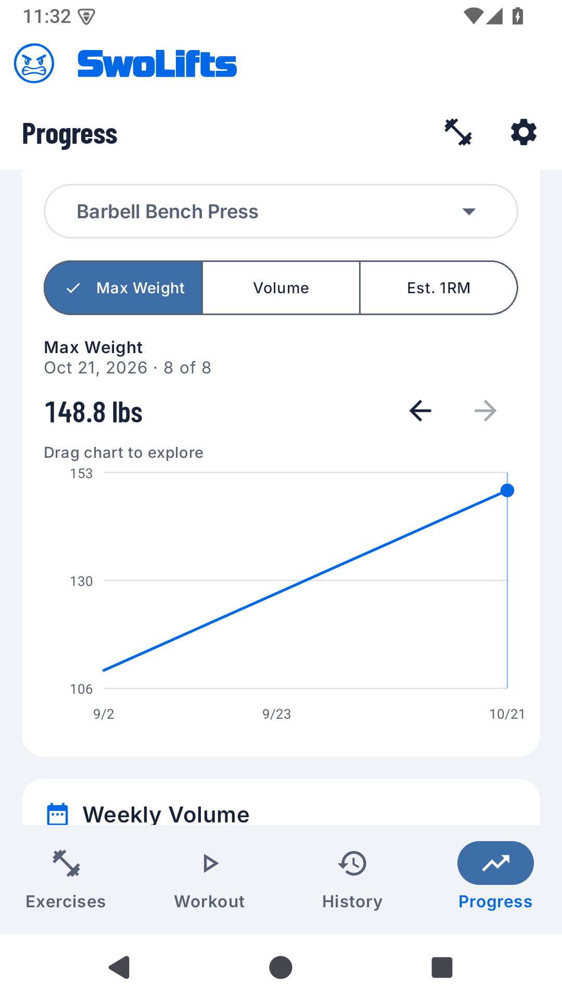
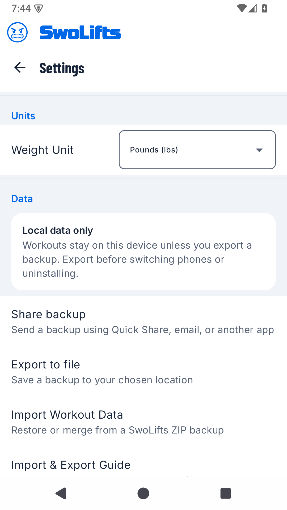

---
{
  "title": "SwoLifts 1.2.0",
  "summary": "Rolling out gradually on Google Play: a refreshed look, clearer workout controls, interactive charts, 421 exercises and easier backup sharing.",
  "status": "published",
  "date": "2026-11-02"
}
---

## Rolling out gradually

SwoLifts 1.2.0 began its production rollout on November 2, 2026. The update may
not appear for everyone yet. Check [Google Play](https://play.google.com/store/apps/details?id=com.swolifts.app)
for availability on your device.

## A refreshed workout experience

- Updated logo, typography and consistent light, dark and system themes.
- Clearer next-set indicators, compact workout controls and a blue rest timer.
- Confirmation before deleting a completed set, to help prevent accidental loss.
- Improved keyboard spacing when adding exercises and editing workouts.
- Drag across progress charts to inspect individual values.

## More exercises, with your history preserved

- The built-in library now includes 421 exercises, with 42 additions.
- Existing production exercise identities and workout history are preserved.
- A custom exercise with the same name stays separate, with its own history and
  personal records. Adding a built-in exercise does not automatically merge it.

## Easier backup and restore

- Use **Settings → Share backup** to send a SwoLifts ZIP through Quick Share,
  email or another app, or **Export to file** to save it to a chosen location.
- Review a backup before restoring it, including warnings about exercise matches.
- Preserve exact saved weights through finishing a workout and backup/restore.
- Backups include current profile bodyweight; restoring fills an empty receiving
  profile and leaves an existing value alone.

Import restores SwoLifts backups. It does not convert another app's workout
history or support creating workouts in a spreadsheet for import. Keep your
original ZIP unchanged; the [Backup Workbench](/swolifts-import-export.html)
lets you inspect a separate copy privately in your browser.

Restore a 1.2.0 backup into 1.2.0 or a later compatible version. Older apps do
not know the new exercise identities. Theme, units, rest-timer and RIR preferences
are not included in backups; set them again after reinstalling or moving phones.
An ordinary in-place update keeps these settings. The wallpaper-based Dynamic
Colors option has been removed in favour of the consistent SwoLifts palette.

## Reliability and privacy

- Finished workouts stay finished after rotation or reopening the app.
- Late finish actions no longer extend an already-ended workout.
- Improved backup compatibility, numeric input and exercise-name handling.
- SwoLifts remains free, offline and usable without an account. Cloud sync,
  AI and subscriptions are not part of this release.
