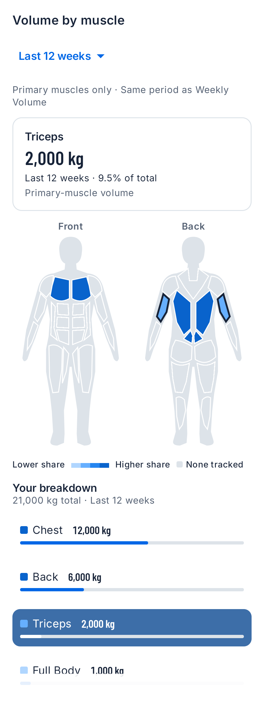
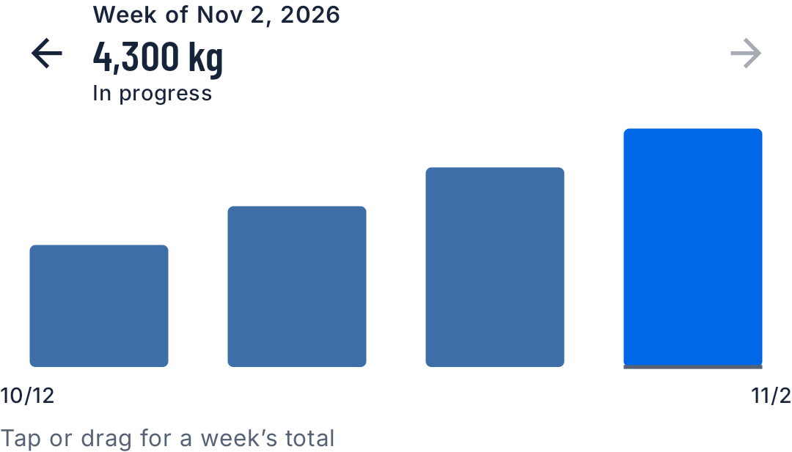
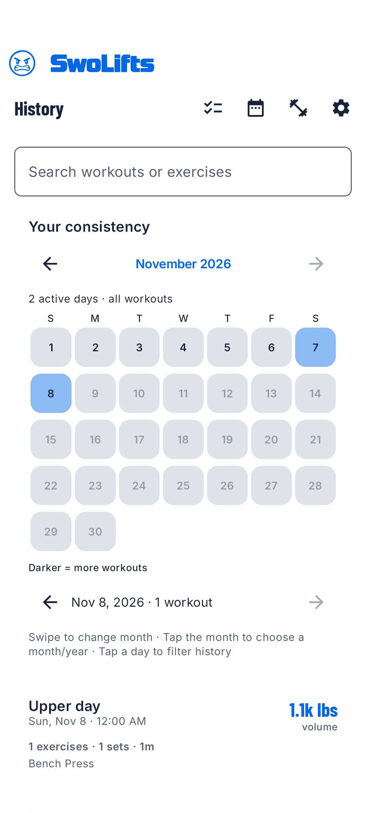
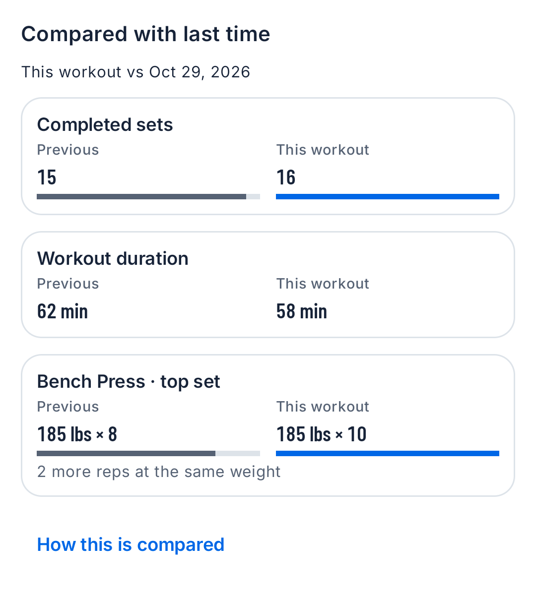

---
{
  "title": "SwoLifts 1.3.0",
  "summary": "A clearer view of your training: muscle maps, interactive weekly volume, searchable workout history and comparisons with last time.",
  "status": "unreleased",
  "date": null
}
---

## Coming in 1.3.0

This update is being prepared and is not yet available on Google Play.
The screenshots below show the Android app with synthetic sample data.

## See where your training volume goes

In **Progress → Muscles**, tap the front or back body map to see a muscle
group's lifting volume and share of the total. The selected period stays visible
beside the reading, so you always know which weeks you are viewing. A numeric
breakdown provides another way to select each group.

The map counts **primary muscles only**. Colour shows recorded lifting-volume
share, not recovery, muscle growth or training quality.

## Explore weekly volume without a long scroll

In **Progress → Volume**, tap or drag across the weekly bars to read the full
total for a week. Previous and next controls provide the same readings without
dragging. Longer histories are paged in groups of up to 12 weeks; each bar
always represents one week.

Progress shortcuts take you directly to Strength, Volume, Muscles and Bodyweight.
History calculations run in the background, and the current view stays visible
while refreshed results are prepared.

## Find a workout and browse your consistency

Search **History** by workout or exercise name, including familiar exercise
abbreviations such as RDL. Search and date filters work together.

In **Your consistency**, swipe or use the arrows to browse months. Tap the month
heading to choose a month and year, or tap a day to filter your workout list.

## Compare a completed workout with last time

Open a completed session or choose **View Summary** after finishing. When a
comparable earlier workout exists, the summary shows completed sets, duration
and a shared weighted exercise's top set, with weight and reps shown separately.
The comparison explains which earlier session it uses.

These are comparisons of your saved workout data, not AI coaching or a claim
that every improvement is an all-time personal record.

## A more accurate record date

Personal records now use the workout's date, including when you enter an older
workout later. Your stored workouts and set timestamps are preserved.

All of these improvements work offline. No account, cloud subscription or AI
service is required. Your existing exercise library and SwoLifts backup format
stay the same.
