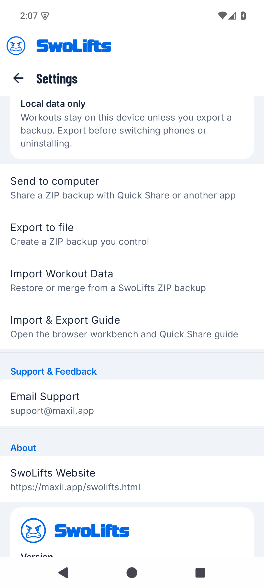

---
{
  "title": "A fresh look for SwoLifts",
  "summary": "Our new logo and website design, clearer guides, and a private place to explore your SwoLifts backups.",
  "status": "published",
  "date": "2026-11-02"
}
---

## A new look, built around SwoLifts

- A new SwoLifts logo, blue colour palette and typography across the website.
- A clearer logo in dark mode, with a browser-tab icon that follows your theme.
- Layouts designed for phones, tablets and larger screens.

## Find your way around

- A direct Guides link for learning how to use the app.
- One Workbench destination for inspecting backups and reading restore instructions.
- Larger app screenshots you can open and browse, plus a sample progress chart to explore.
- Searchable support answers and a Google Play QR code for desktop visitors.

## Explore your backup privately

**Availability update:** the browser workbench is currently hidden while its
scope is reconsidered. The features below describe the original November 2
release. The [backup and restore guide](/swolifts-import-export.html) remains available.

- Open a SwoLifts backup in the browser to inspect your data without uploading it.
- Download an analysis copy or an AI-readable file to use in tools you choose.
- Follow Quick Share or USB instructions to save a backup on your computer.
- Restore the original, unchanged SwoLifts ZIP in the Android app when needed. Importing another app's workout history is outside this workflow.

Find these controls in Settings → Data. Select the screenshot to view it full-size,
or follow the [illustrated backup and restore guide](/swolifts-import-export.html#quick-share).

Sharing instructions require SwoLifts 1.2.0 or later. Version 1.2.0 is rolling out gradually on Google Play, so the update may not appear for everyone yet. See the [Android 1.2.0 release notes](/updates/app-1.2.0.html).
